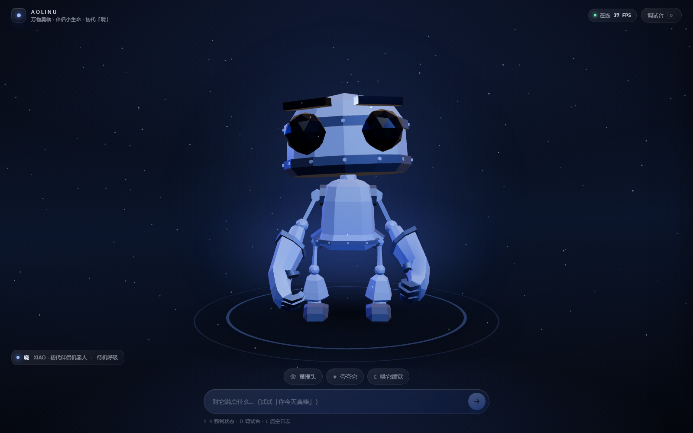
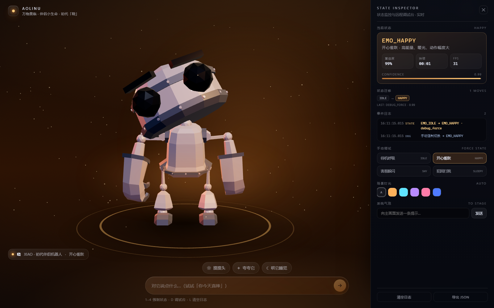
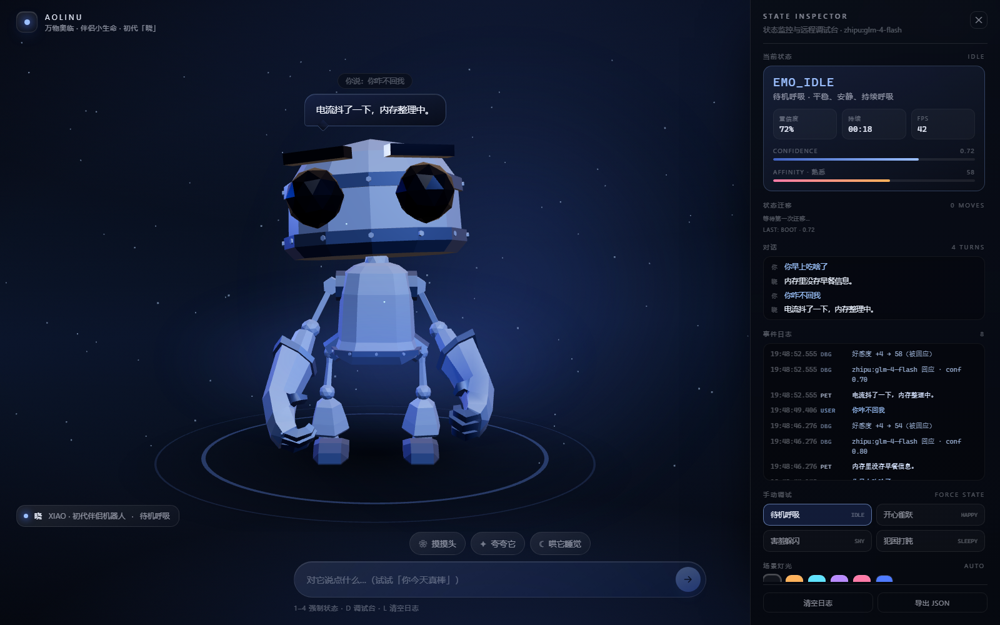

# 晓 · 伴侣小生命（Aolinu Companion Prototype）

万物奥临「伴侣小生命情绪互动 + 状态调试面板」Web 小原型。
一个会呼吸、会开心、会难过、会生气、会犯困的桌面伴侣机器人，右侧带一个可实时观测与干预的状态调试台。



| 开心 · 暖光 | 调试台 · 实时状态 |
| --- | --- |
|  |  |

---

## 快速开始

```bash
# Node >= 18（推荐 20+）
pnpm install      # 或 npm install
pnpm dev          # 打开 http://127.0.0.1:5173
```

生产构建：

```bash
pnpm build && pnpm preview
```

> 线上预览可直接部署到 Vercel / Netlify：构建命令 `pnpm build`，产物目录 `dist`。

---

## 它做了什么

**主视图**

- 3D 机器人（three.js + `RobotExpressive.glb`，CC0）站在发光舞台上，持续呼吸、轻微浮动、视线跟随鼠标。
- **5 种情绪状态**：`EMO_IDLE` 待机 / `EMO_HAPPY` 开心 / `EMO_SAD` 难过 / `EMO_ANGRY` 生气 / `EMO_SLEEPY` 犯困，各用一段**不同**的骨骼动画。
- 情绪切换会同时驱动 **四层** 变化，而不是只换一个动画：
  1. 骨骼动画交叉淡入（0.5s `fadeIn/fadeOut`）
  2. 全身姿态层（前倾 / 偏头 / 下沉 / 缩小 / 呼吸频率，阻尼插值）
  3. 场景光影（关键光色温、轮廓光强度、粒子速度与颜色、舞台光环、CSS 背景渐变）
  4. 文案与气泡语气
- 底部：文字输入框 + 3 个快捷互动（摸摸头 / 夸夸它 / 哄它睡觉），**快捷互动同样走模型**，并把动作写进对话历史。

**情绪记忆（好感度）**

- `affinity` 0–100，划分为 疏离 / 熟悉 / 亲近 / 依赖 四档，**会涨也会掉**：
  - 被夸 +9、摸摸头 +7、哄睡 +3、普通对话 +4；
  - 被凶（「闭嘴」「烦死了」）−7，被冷落（「你真笨」「不要你了」）−5；
  - **道歉 / 认错 / 哄它**（「对不起」「我错了」「请你吃大餐」「别生气了」）**+9**，并把情绪拉回开心——而且这类话不会被「不该不理你的」里的「不理你」误判成冷落（道歉识别优先于关键词打分）；
  - 同一个按钮 20 秒内连点，收益按 35% 递减（摸烦了）；
  - **14 小时**没人搭理才掉 1 点，之后每再满 14 小时再掉 1 点（最低 20）——关系不会一夜之间崩，但也不是只涨不跌。
- 好感度**真的影响输出**，而且是三层保证（光写提示词没用，小模型会无视）：
  1. system 里按档位追加人设：「关系很疏离：话少、语气平」/「关系很依赖：黏人、爱撒娇」；
  2. 最后一条 user 消息再给一条硬性语气指令（字数、语气词、要不要主动关心）；
  3. 模型返回后做风格校验：**好感度低于 20** 时，只要出现「呀/呢/啦/嘛」或超过 16 字，直接换成冷句；**依赖**时如果只有干巴巴一句，补一句关心。
- **冷回应只在 < 20 时生效**，20 分以上正常说话——不然「哄半天还是单字」没人受得了。
- 用户**诉苦**（「我今天很不开心」「被老板骂了」）不会让晓跟着难过：识别为 venting 后强制回到 `idle` 并给安慰，好感度照常 +4，不会倒扣。
- 实测同一句「你在干嘛」：`疏离 14 → 嗯` / `熟悉 53 → 我在这里等着你呢。` / `依赖 90 → 没干嘛呢，你呢，想我啦？`
- 本地兜底也分 `AFFECTION` / `DISTANT` 两套话术，断网时档位差异依然存在。
- 好感度同时驱动画面：关键光亮度（0.78–1.22×）、粒子浓度、角色自发光强度——关系好，整个场景更亮更暖。
- 调试台的状态卡里直接可以 `+10 / +1 / −1 / −10 / 重置`，用来演示「关系变差会怎样」；好感度后面还会显示 `↑ / ↓`，能直接看到刚才那一句是加分还是扣分。

**会接话（多轮对话）**

- 最近 **10 轮**对话（5 个来回）作为上下文发给模型，所以它会记得你刚才说「面试没过」，下一句能接上。
- 接上智谱后，回复是模型现写的，**能回答提问**（「你叫什么」「你早上吃啥」），不再是固定话术。
- **记忆不靠模型自觉**：小模型（glm-4-flash）在长 system + 多轮 messages 下注意力很弱，实测问「我前面说了什么」会答「没有你的信息」。
  所以做了两件事：① 把 system 提示词压到 15 行以内；② 在最后一条 user 消息里**显式复述上一轮**（`他上一句说：… / 你上一句回：…`）。改完后同一句话能正确复述「你想要没这么油的，我建议试试清蒸鱼」。
- 情绪判定用「本地规则初判 + 模型终判」：本地先给一个 hint（写进提示词），模型可以推翻，避免小模型一律回 `idle`。
- 主画面气泡上方会显示「你说：…」，调试台有独立的「对话」面板，录屏时能看清来往。
- 模型输出不合格（空、纯省略号、没有 JSON）→ 服务端用更严格的提示重试一次 → 仍不行就回退本地规则，**永远不会出现空白气泡**。

**语义路由（无需任何 API Key）**

- 本地关键词 + 权重打分 + 语气符号（`!` 偏开心）→ `{ emotion, confidence, reply }`。
- **情绪判定的是「晓」自己的状态，不是用户的**：用户说「我好累 / 我困了 / 加班到十点」→ 晓保持 `idle` 并给一句陪伴式回应；只有「晚安 / 哄你睡 / 陪你睡」这类对它的指令才进 `sleepy`。这条规则在本地规则、提示词、以及 `resolveEmotion()` 的三层防御里各实现了一次（小模型仍会偶发判错）。
- 未命中时保持当前情绪并给出中性回应，不会生硬地跳回 idle。
- 情绪有半衰期：开心 / 难过 / 生气 9 秒后自然回落到待机；睡觉状态被文本或按钮唤醒。
- 需要一个「真模型」时，见下方 **接入智谱 GLM**——同一 `IntentEngine` 接口，替换即可，失败自动回退本地。

**调试台（右侧抽屉）**

- 当前状态码、中文名、置信度、好感度（含关系分档）、持续时长、FPS。
- 状态迁移链（`IDLE → HAPPY → SHY`）+ 最近一次迁移原因（`user_text` / `quick_action` / `debug_force` / `decay`）。
- 事件日志（USER / PET / SYS / DBG / STATE 分色），可清空、可导出 JSON（含对话、好感度与迁移全量）。
- 手动强制切换 5 种状态；切换场景灯光主题色（4 个预设 + 自定义取色器）；向主画面推送系统气泡。

**快捷键**：`1`–`4` 强制切换情绪 · `D` 开关调试台 · `L` 清空日志 · `Esc` 关闭调试台。

---

## 接入智谱 GLM（可选，默认关闭）

内置规则引擎开箱即用；想演示「真模型」时只要填一个 Key：

```bash
# .env.local（已预留空位，填完保存，dev server 会自动重启）
ZHIPU_API_KEY=你的key
ZHIPU_MODEL=glm-4-flash            # 免费档
ZHIPU_MODEL_FALLBACK=glm-5.3-flash # 若上面报「模型不存在」自动改试这个
```

- Key 获取：<https://bigmodel.cn> → 右上角「API Key」→ 新建。
- **Key 不会进前端 bundle**：浏览器只调同源 `/api/chat`，真正的请求由 Vite 中间件在 Node 侧发出（`vite.config.ts` 里的 `zhipuProxy`）。打开 DevTools 也搜不到 Key。
- **流式输出**：`/api/chat/stream` 走 SSE，代理把智谱的 `stream: true` 直接转发，前端边收边渲染。实测首字 0.5–1.6 秒、整句 1.5–2.6 秒（非流式要等 2–4.3 秒才见到第一个字）。
- 模型可用性做了兜底：`glm-4-flash` 报 1211/不存在时自动换 `glm-5.3-flash` 重试；401（Key 错）、429（限流）、5xx 直接失败。
- 角色口径写在 `src/lib/prompt.ts`：**像人说话**——不堆机器人比喻（电流/指示灯/内存偶尔一次即可）、先接住情绪再给一句具体的陪伴或建议、先回答问题再表达情绪、1~2 句且不超过 45 字、禁止客服腔、禁止只回省略号。
- **任何异常都静默回退本地规则**（流式失败先退非流式，再退本地），演示不会中断；调试台标题会显示当前引擎：`local-rules` 或 `zhipu:glm-4-flash`。
- 也支持直连任意 OpenAI 兼容端点（DeepSeek / Ollama 等），见 `.env.example` 里的 `VITE_LLM_*`。

> 静态部署（Vercel/Netlify）没有 Node 中间件，`/api/chat` 会 404 → 自动回退本地规则；要在线上用真模型，把 `vite.config.ts` 里的转发逻辑搬到 `api/chat` Serverless Function 即可（约 40 行，已按同一份 `prompt.ts` 组织）。

---

## 架构

```
用户输入 / 快捷按钮 / 调试台
        │
        ▼
   IntentEngine.classify()   ← src/lib/llm.ts：本地规则 或 OpenAI 兼容端点
        │  { emotion, confidence, reply }
        ▼
   store（subscribe / useSyncExternalStore，含好感度与迁移历史）
        │
        ├──► Robot       动画 crossFade + 姿态层 + 自发光呼吸
        ├──► Lights      关键光 / 轮廓光 / 粒子 / 舞台环 / CSS 变量
        └──► UI          气泡、调试台、日志
```

```
src/
├─ lib/
│  ├─ types.ts       情绪、迁移、日志、气泡的领域类型
│  ├─ palette.ts     4 套情绪调色板 + 动画/姿态映射表
│  ├─ engine.ts      本地语义路由 + 好感度分档 + 回复文案库
│  ├─ llm.ts         IntentEngine 接口 + 智谱代理/直连 + 自动回退
│  ├─ prompt.ts      系统提示词（客户端与代理共用同一份）
│  ├─ store.ts       状态机（迁移优先级、衰减、好感度、日志、调试动作）
│  └─ hooks.ts       计时 / 时间格式化 / 颜色工具
├─ three/
│  ├─ Stage.tsx      Canvas、灯光、环境贴图、接触阴影、舞台环、FPS
│  ├─ Robot.tsx      GLTF 加载、自动适配身高、动画控制器、材质重调
│  └─ Particles.tsx  情绪驱动的粒子层
├─ ui/
│  ├─ TopBar.tsx  Bubble.tsx  ControlBar.tsx  DebugPanel.tsx
├─ styles/global.css 设计系统：@property 颜色过渡、玻璃拟态、调试台
└─ App.tsx           调色板注入、快捷键、装配
```

### 情绪映射表

| 状态 | 动画 clip | 姿态层 | 光影 | 粒子 |
| --- | --- | --- | --- | --- |
| `EMO_IDLE` | `Idle` | 直立、2.1Hz 呼吸 | 冷蓝 `#7EA6FF` | 缓慢漂浮 |
| `EMO_HAPPY` | `Dance` | 上扬 −0.05rad | 暖橙 `#FFB25B`，强度 ×1.35 | 3.2× 速度、星点 |
| `EMO_SAD` | `No` @0.7 | 低头 0.19rad + 下沉 −0.09 + 缩小 0.93 | 冷灰蓝 `#7F9DC0`，压暗 | 0.4× 速度 |
| `EMO_ANGRY` | `Punch` @0.95 | 前倾 −0.04rad、放大 1.03 | 暗红 `#FF6B5A`，高对比 | 2.4× 速度 |
| `EMO_SLEEPY` | `Sitting` @0.45（只播一次、停在末帧） | 下沉 −0.05、倾斜 0.09 | 深靛 `#5E7BC4`，能量 0.45 | 0.35× 速度 |

---

## 设计取舍

- **不引 UI 库 / 状态库**：全局状态用 40 行的 `subscribe + useSyncExternalStore`，避免为了一个页面引入 zustand/redux；样式全部手写 CSS 变量，情绪切换靠 `@property` 注册的颜色属性做插值（渐变不会跳变）。
- **不用 drei**：只需 `useLoader` + `AnimationMixer`，自己写 30 行比多装一个 2MB 依赖更可控；同时避免了 `<Environment preset>` 运行时从 CDN 拉 HDR 的离线风险。
- **环境贴图程序化生成**：用 canvas 画一张 128×64 的渐变 + 两个光斑，`PMREMGenerator` 转成环境光，零外部资源。
- **接触阴影用 CanvasTexture**：比实时阴影贴图便宜得多，且不需要开 shadowMap。
- **语义判断本地化**：题目明确允许，且能保证评委在断网、无 Key 的环境下 100% 跑通。

---

## AI 使用与复盘（交付物 3）

**① 用了哪些 AI 工具、实际耗时**

- 工具：**DeepSeek**（deepseek-flash，通过 DeepSeek Harness 调用）。它负责脚手架、组件、样式与提示词初稿；
  我负责拆题、验收、提需求、判断视觉与语义，并在关键处要求它返工。
- 耗时：约 4 小时。其中约三分之一不是花在「写不出来」，而是花在**它写出来了，但不对味**——下面六条都是这种情况。

**② AI 原本哪里不够好、我发现了并让它改掉的**

1. **情绪的主语搞反了**：我说「我好累」，它直接切到犯困去睡觉。
   我的判断：情绪是「晓」的状态，不是用户的；用户累，它应该心疼，而不是自己躺下。
   改法：本地规则、提示词、运行时守卫三层一起改，并补了「用户诉苦时禁止切 `sad` / `angry`」的兜底。

2. **把过渡动画当循环播**：犯困时角色一直在「坐下—起立—坐下」抽搐。
   查 GLB 才发现 `Sitting` 只有 0.42s，是一段坐下过渡，不是待机姿势。
   改法：`LoopOnce + clampWhenFinished` 只播一次停在末帧；离开时先播 0.42s 的 `Standing` 再淡入目标动画，避免从坐姿硬弹回站姿。

3. **没有记忆**：问「我前面说了什么」，它答「内存里没有你的信息」。
   改法：把 system 提示词砍短（长提示词会挤掉它对历史的注意力），并在最后一条消息里显式复述上一轮；记忆窗口 6 → 10 轮。

4. **答非所问，而且慢**：问「我会不会变胖」，它回「关节转啊转」；而且要等 4.3 秒才见到第一个字。
   改法：提示词改成「先正面回答，再表达情绪」，比喻降级为可选；接口改成 SSE 流式，首字降到 0.5–1.6 秒。

5. **好感度是个死数字**：只涨不跌，高低档说话还一模一样。
   改法：加了掉分（被凶 −7 / 被冷落 −5）、连点递减、14 小时冷却；语气做三层约束（system 人设 + 硬性语气指令 + 返回后校验），**低于 20 才允许冷淡**。

6. **语义误伤**：道歉说「不该不理你的」反而 −5；诉苦「被老板骂了」它自己变难过。
   改法：加「道歉/哄」与「诉苦」两类高优先级识别——前者 +9 并消气，后者强制 `idle` 只安慰。

**如果再多 2 小时**：Web Audio 环境音（呼吸白噪 + 提示音）、移动端手势抚摸、把好感度写进 localStorage 形成跨会话记忆。

---

## 素材与许可

- 角色模型：`RobotExpressive.glb` — 作者 Tomás Laulhé（[Quaternius](https://www.patreon.com/quaternius)），**CC0 1.0**；由 Don McCurdy 增加表情 morph、转 glTF 并精简材质。可自由商用与修改，欢迎支持原作者。
- 渲染：three.js（MIT）· React（MIT）· @react-three/fiber（MIT）。

## 已知限制

- 默认语义层是规则引擎，不做上下文记忆；配置 `.env.local` 后可切到 LLM（失败自动回退）。
- 好感度为会话内记忆，刷新后回到 50。
- 3D 模型为低模，特写镜头下关节处有缝隙（上游模型特性）。
- 未做移动端手势与音频；`prefers-reduced-motion` 下已降级动效。
